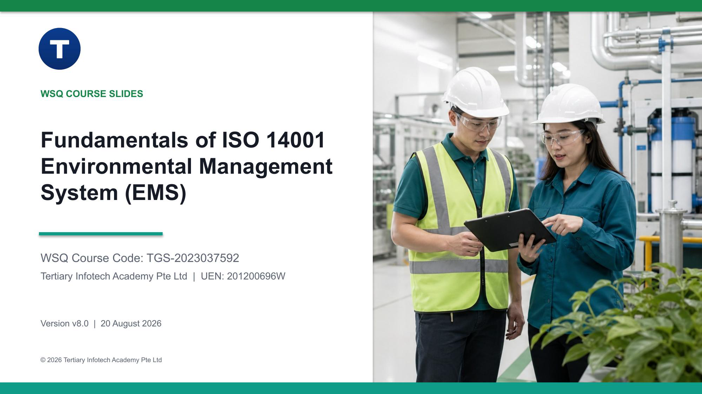

# Fundamentals of ISO 14001 Environmental Management System (EMS)

WSQ courseware for **TGS-2023037592**, prepared by Tertiary Infotech Academy Pte Ltd.

| Course detail | Information |
|---|---|
| Course code | `TGS-2023037592` |
| Programme | WSQ (SkillsFuture Singapore) |
| Duration | 2 days, 16 hours (including 2-hour assessment) |
| Registration | [View course details and register](https://www.tertiarycourses.com.sg/wsq-fundamentals-of-iso-14001-environmental-management-system-ems.html) |
| Funding | Up to 70% WSQ course fee funding for eligible learners (50% baseline for Singapore Citizens/PRs aged 21+; 70% for Singapore Citizens aged 40+ under MCES or SME-sponsored learners). Eligibility and terms apply - see the course page. |
| Provider | Tertiary Infotech Academy Pte Ltd |

## Package contents

- `courseware/` — trainer/learner slide deck in PPTX and PDF, detailed Learner Guide in DOCX/PDF/Markdown, and Lesson Plan in DOCX/PDF.
- `activities/` — eight self-contained, connected Meridian EcoPack case activities. Every folder contains detailed Markdown/PDF instructions, a scenario/checklist PDF, and an editable Excel evidence workbook.
- `SOURCE-COVERAGE-v8.md` — legacy-content preservation, source authority, and K/A traceability record.
- `QA-REPORT-v8.md` — generation and release quality evidence.

Assessment papers and answer keys are trainer-controlled and are intentionally excluded from this public repository.

## Learning outcomes

Learners identify environmental hazards and assess risk; determine accident response and reporting; evaluate environmental hazards and oversee EMS training/assessment; and improve ISO 14001 EMS outcomes through continual improvement.

## Current-edition note

Version 8.0 teaches ISO 14001:2026 as the current published edition as at 20 August 2026. The courseware paraphrases management-system concepts and does not reproduce the copyrighted standard or provide legal advice. Formal conformity work requires a licensed copy of the applicable standard and verification of current obligations with authoritative sources.

## Course and materials

- [Course page](https://www.tertiarycourses.com.sg/wsq-fundamentals-of-iso-14001-environmental-management-system-ems.html)
- [Public courseware folder](https://drive.google.com/drive/folders/12yLNRcT3RMMzPP11z6i9oXWXd4KbPTHQ)

© 2026 Tertiary Infotech Academy Pte Ltd. All rights reserved.
